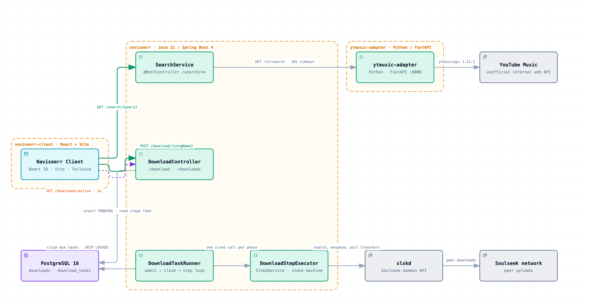
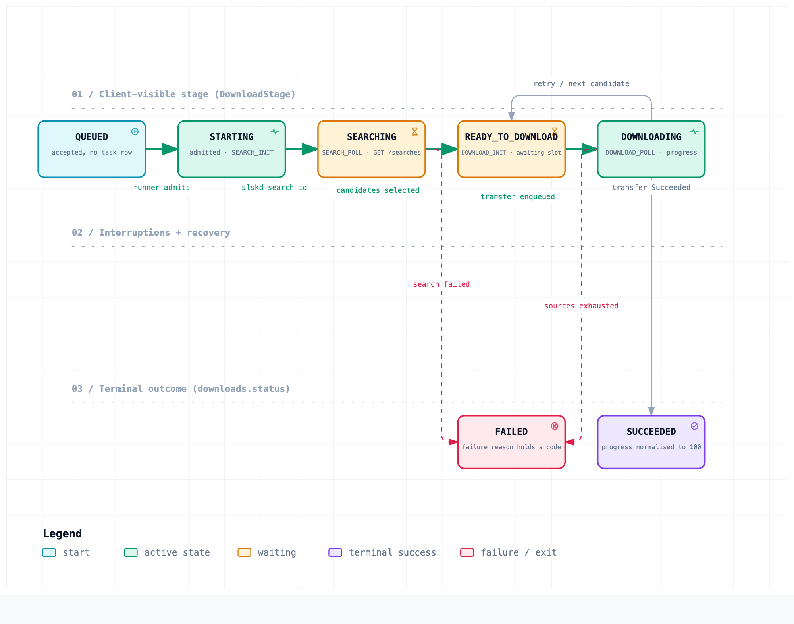

The aim of this project is to provide a service that can be used to search tracks, artists and albums and download them using free sources such as the soulseek network (slskd), torrent indexers and any other solutions possible.

This repository is the server. The web app lives in [naviseerr-client](https://github.com/catacomb5099/naviseerr-client); the install below includes both.

## Install

This section is for running naviseerr at home, not for working on its code. One command starts
everything: the naviseerr server, its web app, its own Soulseek client
([slskd](https://github.com/slskd/slskd); Soulseek is the file-sharing network naviseerr downloads
from), a database, the helper that searches YouTube Music, and the maker of the weekly suggested
playlists (the "Made for you" shelf on the Home page). Every song and playlist you download lands in
one music folder, ready for [Navidrome](https://www.navidrome.org/) or
[Jellyfin](https://jellyfin.org/) to play.

### What you need

- A computer that stays switched on: a home server, a NAS or a spare PC.
- Docker, which runs each part in its own sealed box (a "container"):
  [install Docker](https://docs.docker.com/get-started/get-docker/). Docker Desktop on Windows and macOS,
  Docker Engine on Linux. Both include `docker compose` (version 2.24 or newer). On Linux, run the
  `docker` commands below with `sudo`, or first
  [add yourself to the `docker` group](https://docs.docker.com/engine/install/linux-postinstall/).
- `git`, to download this project.
- About 4 GB of free disk space for naviseerr itself (the first start downloads at least 700 MB), plus
  room for your music, and about 700 MB of free memory (the playlist maker takes about 40 MB of that
  when idle).

### Steps

1. Download naviseerr and go into its folder. `-b move-fast-break-things` picks the branch with the
   newest version:
   ```sh
   git clone -b move-fast-break-things https://github.com/catacomb5099/naviseerr.git
   cd naviseerr
   ```
2. Say where your music goes. Make the settings file and fill in `LIBRARY_DIR=` in a text editor with
   the folder your music library lives in, for example `/srv/music` or `/Volumes/NAS/Music`:
   ```sh
   cp .env.example .env
   ```
   The folder must already exist: naviseerr never invents one for you, so a mistyped path stops the
   start instead of quietly filling a new empty folder on the wrong disk. `LIBRARY_DIR=./library`
   keeps the old default, a `library/` folder inside this one (`mkdir library` first). Everything else
   is optional and made up or defaulted when left empty, including the Soulseek username
   (`naviseerr-xxxxxx`) and its password. A name of your own (`SOULSEEK_USERNAME=`) is friendlier on
   the network than a generated one: the account is created the first time naviseerr logs in, so pick
   one nobody else is likely to have (1 to 30 characters, no accents or emoji). `SHARE_LIBRARY`: your
   music folder is shared on Soulseek unless you set it to `false`. If you change `SHARE_LIBRARY`
   after the first start, run `docker compose up -d` and then `docker compose restart slskd`: until
   that restart, slskd keeps sharing what it shared before.
3. Start it:
   ```sh
   docker compose up -d
   ```
   The first start builds everything from source and takes several minutes. Later starts take seconds.
   `docker compose ps` shows what is running.
4. Save your Soulseek account. The first start prints the username and the password once:
   ```sh
   docker compose logs setup
   ```
   Later runs print the username only; both are in `docker compose exec slskd cat /app/slskd.yml` (the
   `username:` and `password:` under `soulseek:`). Keep them somewhere safe: **Soulseek passwords
   cannot be reset.**
5. Open the web app at `http://<this computer's address>:5056`, or http://localhost:5056 on the same
   computer. Is it working? `docker compose ps` shows every part running, the web app has no amber
   "Not connected to Soulseek" strip across its top (it stays until the Soulseek login works), and
   `docker compose logs slskd` does not keep saying "Failed to reconnect" (slskd cannot reach
   Soulseek) or "invalid username or password" (see Troubleshooting). The Home page's "Made for you"
   shelf is empty at first: press "Make this week's playlists now" there and the playlist maker
   builds all 49 playlists (about an hour and a half; they appear as each one finishes). After that
   a new edition is made every Monday at 03:00 (`TZ` in `.env`). It needs the internet (Discogs and
   YouTube Music); an optional free Discogs token in `.env` (`DISCOGS_TOKEN`) makes the run quicker.
6. Point your music app at the music folder (`LIBRARY_DIR`). If your music app runs in Docker too, give
   its container the same folder.
   - **Navidrome:** its music folder must be `LIBRARY_DIR` or a folder that contains it. Playlists are
     imported by themselves. They belong to the first admin account. Admin accounts see them; other
     accounts only if you start Navidrome with `ND_DEFAULTPLAYLISTPUBLICVISIBILITY=true`. Navidrome
     0.61 or newer also shows the playlist's own picture (naviseerr writes it next to the playlist file;
     YouTube Music playlists, user playlists and your own playlists with a picture you chose: a suggested playlist keeps the mosaic, since the app draws its
     cover rather than storing one); older versions show a mosaic of the songs' covers.
   - **Jellyfin:** add `LIBRARY_DIR` to a library of type Music. Playlists appear for everyone who can
     see that library. Tested with Jellyfin 12.1.0 and 12.2.0. If a playlist shows up empty on your version, see
     [issue #18169](https://github.com/jellyfin/jellyfin/issues/18169). Jellyfin reads no picture file
     for playlists; it shows a collage of the songs' covers unless naviseerr is connected to it (next bullet),
     in which case naviseerr sends the playlist's own picture (the same playlists as above) through Jellyfin's
     API a few seconds after the rescan (Jellyfin then saves its own copy, `<playlist name>-poster.jpg`, next
     to the file).
   - **Optional: have it rescan the moment a download is filed.** Music apps notice new files by
     themselves only when they run on the same Linux host; over a NAS share, from another machine or on
     Docker Desktop they see nothing until they scan. Put the app's address and login in `.env`
     (`NAVIDROME_URL` + `NAVIDROME_USER` + `NAVIDROME_PASSWORD`, an admin account, since Navidrome only
     lets admins start a scan; `JELLYFIN_URL` + `JELLYFIN_API_KEY` from Dashboard -> API Keys), then
     `docker compose up -d`. Each finished download then triggers one rescan (at most one every 30 s).
     A wrong address or login shows once in `docker compose logs naviseerr` ("Could not ask Navidrome to
     rescan the library: ...") and in `GET /api/status` under `library.mediaServers`; nothing else breaks.
7. Optional, but you get more search results and fewer failed downloads: on your router's "port
   forwarding" page, forward TCP port 50300 to this computer. That is the door other Soulseek users
   knock on; slskd cannot open it by itself. **Do not forward port 5056 on your router as it is:** the web
   app has no login until you connect Authentik, and even then it should sit behind a reverse proxy with
   HTTPS. See "Log in with Authentik" and "Exposing naviseerr on the internet" below.

### Log in with Authentik

Out of the box the web app has no login: fine on your own network, not fine on the internet. If you
run [Authentik](https://goauthentik.io/) (or want to: it is one more container), naviseerr can hand its
door to it. Nothing to put in a file: it is all in the web app. About eight clicks in Authentik and
three fields in naviseerr.

**In Authentik** (2026.8; the words are its own):

1. **Applications -> Applications -> Create with Provider.** Application name `naviseerr`, slug
   `naviseerr` (the slug becomes part of the address below; keep it plain).
2. Provider type **OAuth2/OpenID Provider**. Name it `naviseerr` too. Authorization flow:
   `default-provider-authorization-implicit-consent` (no "do you consent" page each time; the explicit
   one works too). Authentication flow and Invalidation flow: leave the pre-filled defaults.
3. **Client type: Confidential.** Leave Client ID and Client Secret as generated and copy both
   somewhere for a minute.
4. **Redirect URIs/Origins:** paste the **Redirect URL** that naviseerr shows under Settings -> Login
   (the gear top right). It reads `https://<your address>/api/auth/authentik/callback`, and Authentik
   matches it strictly: connect from the address you will really use (your domain, behind HTTPS), not
   from `localhost`. Signing key: any (naviseerr trusts the connection to Authentik rather than the
   token's signature; OpenID Connect allows this when the token comes straight from the token endpoint).
   Encryption key: leave empty (naviseerr reads the token; it cannot decrypt one).
5. Finish the wizard. On the provider's page, copy **OpenID Configuration Issuer**
   (`https://auth.example.com/application/o/naviseerr/`).
6. Open the application you just made -> **Policy / Group / User Bindings -> Bind existing policy/group/user**
   -> **User** -> yourself. **This is what decides who may use naviseerr:** whoever Authentik lets into
   this application gets in. With no binding, every Authentik user does.

**In naviseerr:** Settings (the gear top right) -> Login. Paste the Issuer into **Authentik address**,
then **Client ID** and **Client secret**, press **Save and test**. It reads Authentik's settings, tries
the Client ID, secret and Redirect URL against it, and says "Authentik answered at ... and accepted the
Client ID, secret and Redirect URL", or what to fix in plain words (a wrong slug answers 404; a Client ID
or secret Authentik does not accept, or a Redirect URL not yet in its Redirect URIs, is named and nothing
is saved, as is a token endpoint that answers an error page instead of refusing the test code (Authentik
unhealthy, or a proxy in the way); "could not reach" means this server cannot see Authentik's address: both your browser and the
naviseerr container must be able to reach it, so `localhost` will not do in Docker). **A successful Save
and test turns the login on at once:** from that moment every visitor sees "Continue with Authentik"
first, and `https://<your address>/api/...` answers 401 without a session. The page says "The login is
on. Sign in to carry on.": press **Continue with Authentik**, sign in there, and you are back in naviseerr
on the same page, signed in. A wrong Client ID, secret or Redirect URL cannot lock you out, because Save
and test refuses it and saves nothing; if Authentik itself goes away later, Troubleshooting's "Locked out"
line opens the app again. You stay signed in for 30 days per device, a
server restart included; "Log out" (top right) ends naviseerr's session only, Authentik's stays, so the
next "Continue with Authentik" is one click. **Turn off Authentik login** in Settings opens the app
again and logs everyone out; the settings are kept, and Save and test (with the secret field left
empty) turns it back on.

Do it **before** you open your proxy to the internet: until Save and test has succeeded, anyone who can
reach the page could connect their own Authentik instead (see Troubleshooting, "Locked out", for the way
back in if that ever happens). naviseerr keeps no accounts of its own and shows no names; nothing in it
is per-user. The server stores only Authentik's stable id for you, and your Client secret, in its
database.

### Exposing naviseerr on the internet

With the web app behind a reverse proxy on your own domain, Authentik is what stands between the
internet and your downloads (a bot that got in could hammer search until YouTube Music blocks your
address, or start downloads until the disk is full). What the app does for you, and what you do:

- **Connect Authentik first** (the section above) before the proxy is open to the world. The login is
  on from the moment Save and test succeeds; until then the web app is open to anyone who can reach it.
- **Bind the Authentik application to your own user.** Whoever Authentik admits to the application may
  use naviseerr; the binding is how it admits only you.
- **HTTPS at your proxy.** Your proxy owns the certificate; the login cookie is marked Secure by itself
  when the request arrived over HTTPS (the web app passes `X-Forwarded-Proto` on from a proxy on your
  own network or Docker network), and the Redirect URL shown in Settings reads `https://`. The web
  app's own answers carry the usual browser hardening headers (no type sniffing, no framing by other
  sites, no camera or location prompts); add HSTS at your proxy if you want it.
- **Your proxy must pass the `Host` header through unchanged** (Nginx Proxy Manager, Traefik, Caddy and
  Cloudflare do by default; plain nginx needs `proxy_set_header Host $host;`). The server uses it for
  the Redirect URL and to tell the web app's own calls from another site's.
- **Only the web app's own address may call the API from a browser** with your login cookie. The
  install needs nothing for that (the web app and the API share one address, through your proxy too),
  and the Docker image allows no other address at all. Any other address is refused (a bodiless 403 on
  every call, login on or off): the naviseerr Chrome extension needs `chrome-extension://<its id>` in
  `AUTH_ALLOWED_ORIGINS` on the container, and host permissions in the extension do not help. Developers
  running the web app on another port have `http://localhost:5173` allowed by the jar's default, or list
  theirs in `AUTH_ALLOWED_ORIGINS` (`.env.example`).
- **Authentik over plain HTTP on your LAN** is fine for a home network, but the trust in Authentik's
  answers rests on that connection; on the internet, Authentik itself must be behind HTTPS too.
- **Nothing else of the API answers without a login** once it is on: a bot cannot search or download at
  all. Authentik's own login page takes the brute force, with its own limits and logs.

### Help improve search (optional, off by default)

naviseerr can share what worked for each song it downloads, so the search rules can be tuned on real
results: the song's name, the words searched, how many files each search found and the file picked (its
name, type, quality and length). Never Soulseek user names, your IP address or where your files are kept.
Nothing is sent until you set an address AND switch **Settings → Help improve search** on, and only songs
that finish after that moment are sent. To send to your own croissant (the playlist maker), add to
`compose.override.yaml` (next to `compose.yaml`; create it if it is not there) and run `docker compose up -d`:

```yaml
services:
  naviseerr:
    environment:
      SEARCH_LEARNING_URL: http://croissant:8010/v1/search-reports
      # croissant's token: docker compose exec naviseerr cat /config/curator.token
      SEARCH_LEARNING_TOKEN: <that token>
```

`GET /search-learning/reports` on your naviseerr shows the reports themselves (the same text that is sent),
whether the switch is on or not.

### Updating

```sh
git pull && docker compose up -d --build
```

Keep the `--build`: `docker compose up -d` on its own only restarts what you already have and never
rebuilds the YouTube Music helper (`ytmusic-adapter`), so an update that needs a newer helper, such as
the pictures of similar artists, quietly stays off. The server then prints a warning, see Troubleshooting.

**Updating from before 09-10-2026, when the music folder had a default:** `LIBRARY_DIR` is now
required. If you never set it, add `LIBRARY_DIR=./library` to `.env` (the folder the old default
used, inside this one) before `docker compose up`; until then every `docker compose` command,
`stop` and `logs` included, stops with "required variable LIBRARY_DIR is missing a value".

**Updating from before 09-10-2026, if you started the playlist maker with `--profile curator`:** drop
the flag, it is part of the plain `docker compose up -d --build` now, and its secret is generated
for you. The `CURATOR_TOKEN=` line in your `.env` is no longer read by the install; delete it or
leave it. Your existing playlists stay.

### Stopping, removing and backing up

- **Stop:** `docker compose stop`, or `docker compose down`, which also removes the containers. Both
  keep your settings, passwords, download history and music; `docker compose up -d` starts it again.
- **Remove everything:** `docker compose down -v`. **This deletes your generated Soulseek username
  and password for good, and your download history. Soulseek passwords cannot be reset: without a
  copy, that Soulseek account is lost.** It also deletes the suggested playlists (the next run makes
  new ones). Back up first. Your music folder (`LIBRARY_DIR`) is an ordinary folder
  and stays; delete it yourself if you want it gone.
- **Back up** while naviseerr is running or stopped with `docker compose stop` (after
  `docker compose down`, run `docker compose up -d` first: the command below needs its containers):
  - The generated username and passwords, the part of naviseerr's config that cannot be made again:
    ```sh
    docker compose cp setup:/config/secrets.env ./naviseerr-secrets.env
    ```
    Move `naviseerr-secrets.env` somewhere safe. To use the same Soulseek account on a new install,
    copy its `SOULSEEK_USERNAME=` and `SOULSEEK_PASSWORD=` lines into `.env`.
  - Your music: copy `LIBRARY_DIR` like any other folder, or add it to the backups you already make.

### Troubleshooting

- **"required variable LIBRARY_DIR is missing a value".** `.env` has no `LIBRARY_DIR` (or an empty
  one). Add `LIBRARY_DIR=/path/to/your/music` (see step 2); `LIBRARY_DIR=./library` is the old
  default. Nothing runs, not even `docker compose stop`, until it is set.
- **"bind source path does not exist: /some/path".** `LIBRARY_DIR` points at a folder that is not
  there, a typo most often. Fix the path in `.env`, or create the folder (`mkdir -p /some/path`), then
  `docker compose up -d`. naviseerr never creates it for you, so a wrong path cannot quietly become a
  new empty library on the wrong disk.
- **Nothing starts.** `docker compose logs setup` says what is wrong, in one block naming the setting
  and the fix, for example a `SOULSEEK_USERNAME` in `.env` that breaks Soulseek's rules (leave it empty
  and a name is made up for you), a `PUID` that is not a number, or one of the two library problems
  below.
- **"cannot be written to by user 1000:1000"** (in `docker compose logs setup`). The containers run as
  `PUID`:`PGID` from `.env`, and that user may not write into `LIBRARY_DIR`. Linux: give the folder to
  that user (`sudo chown 1000:1000 /path/to/music`) or set `PUID` and `PGID` to the folder's owner
  (`ls -ln` shows the numbers). Docker Desktop (macOS, Windows): make the folder writable by your own
  account; `PUID`/`PGID` play no part there. Then `docker compose up -d`.
- **"the small marker file naviseerr left there last time is gone".** `LIBRARY_DIR` is empty, but it
  was your library at the last start: most likely the disk or network share it lives on is not mounted,
  and starting anyway would fill a new empty folder on the system disk. Mount it (or fix the path in
  `.env`) and `docker compose up -d`. If you emptied the folder on purpose, say so with
  `touch /path/to/music/.naviseerr-library`. That hidden file is how naviseerr recognises its library;
  slskd never shares it, and Navidrome and Jellyfin ignore it. Leave it there. The check only fires
  when the folder is completely empty: a mount point that still holds something (a `lost+found`
  folder, say) is not caught.
- **"YouTube Music isn't answering" strip** across the web app (search fails and new downloads wait while it
  shows). The YouTube Music helper is down or cannot reach YouTube from inside its container; the
  server's own search just before it will have logged one "YouTube Music is not answering" warning.
  `docker compose logs ytmusic-adapter` says which: "Could not reach YouTube Music
  (NameResolutionError)" is DNS inside the container (check Docker's DNS, or
  `docker compose exec ytmusic-adapter python -c "import socket; print(socket.gethostbyname('music.youtube.com'))"`),
  "Upstream rate limit exceeded" is YouTube itself asking for a pause (wait a few minutes; nothing
  to fix), and no answer at all means the container is not running (`docker compose up -d`). The
  strip clears by itself within about a minute of YouTube Music answering again.
- **"Username taken".** The web app keeps its "Not connected to Soulseek" strip, and
  `docker compose logs slskd` says "invalid username or password": someone
  else already has that name. Choose another `SOULSEEK_USERNAME` in `.env`, run `docker compose up -d`,
  then `docker compose restart slskd` (slskd tries to log in once and then waits). The strip goes
  within about 30 seconds of the login working, or reload the page.
- **Linux: permission errors** ("permission denied", "Could not file song") on a library that was
  writable when setup checked it (a folder inside it owned by someone else, say). Every container runs
  as one user, `PUID`:`PGID` in `.env` (default 1000:1000). They must be allowed to write into
  `LIBRARY_DIR` and its folders: set them to the folder's owner (`ls -ln` shows its numbers; `id -u`
  and `id -g` show yours), then run `docker compose up -d`.
- **Similar artists have no pictures** (grey circles with names on an artist page), and
  `docker compose logs naviseerr` says "similar artists arrived without a picture ... ytmusic-adapter
  is probably out of date". The YouTube Music helper is an old build: run `docker compose up -d --build`.
- **Suggested playlists missing** ("Couldn't load your suggested playlists" on the Home page, or the
  shelf stays empty after a run). `docker compose ps` should show `croissant` running and healthy;
  `docker compose logs croissant` says what its last run did. The playlist maker needs the internet
  (Discogs and YouTube Music) from this computer. The shelf's "Make this week's playlists now" button
  runs it again; `docker compose logs naviseerr | grep -i curator` shows what naviseerr saw. "rejected
  the token (401)" there means the two sides hold different tokens: `docker compose up -d` rewrites
  both from the one in the config volume.
- **Locked out of the web app** (Authentik is down or gone, its application was deleted, or somebody
  else connected their Authentik first). Open the login's own switch from the database, no restart
  needed, the next page load is open again:
  ```sh
  docker compose exec postgres psql -U naviseerr -d naviseerr -c "UPDATE login_settings SET enabled = false"
  ```
  Then Settings -> Login: fix the values or connect your own Authentik and press Save and test, which
  turns the login back on, then sign in. If you have no terminal (TrueNAS: the postgres container's
  Shell), the same statement runs there.
- **Playlists missing.** Check, in order:
  1. The playlist download finished with at least one song: the playlist file is written once one of
     its songs is in the library.
  2. The file is there: `LIBRARY_DIR/Playlists/<playlist name>.m3u8`.
  3. Your music app's library covers the whole `LIBRARY_DIR` (not just one artist folder) and has
     scanned since. With `NAVIDROME_URL` / `JELLYFIN_URL` set, `docker compose logs naviseerr` shows
     `Asked Navidrome to rescan the library` right after the playlist was written; a `Could not ask ...`
     line there says what is wrong with the address or login.
  4. Navidrome: you are logged in as an admin, or `ND_DEFAULTPLAYLISTPUBLICVISIBILITY=true`.
  5. Jellyfin: the library type is Music (and see issue #18169 if a playlist is there but empty).
  6. Playlists downloaded before this install are not added afterwards.

## [Architecture](https://raw.githack.com/catacomb5099/naviseerr/master/docs/architecture/diagrams/system-architecture.html)

<picture>
  <source media="(prefers-color-scheme: dark)" srcset="docs/architecture/diagrams/system-architecture-dark.png">
  
</picture>

Three repositories, one stack: this one, [`naviseerr-client`](https://github.com/catacomb5099/naviseerr-client)
(React 18 + Vite), and [`ytmusic-adapter`](https://github.com/catacomb5099/ytmusicapi)
(a FastAPI sidecar over `ytmusicapi`). The client reaches search and downloads the same way —
plain REST against the search, collection and download controllers. Nothing streams; the client polls `/downloads/active`.

The diagram above is a static export. The **interactive** version — pan and zoom, click any
component to trace its relationships, plus guided walkthroughs of the search path, the
download-initiation path and the download lifecycle — is one self-contained HTML file:
[`docs/architecture/diagrams/system-architecture.html`](docs/architecture/diagrams/system-architecture.html).

GitHub serves `.html` as source rather than rendering it, so open it one of these ways:

- **[Open the interactive diagram](https://raw.githack.com/catacomb5099/naviseerr/master/docs/architecture/diagrams/system-architecture.html)** (via raw.githack.com)
- `git clone` and open the file in any browser — it has no dependencies and needs no server

### Download lifecycle

<picture>
  <source media="(prefers-color-scheme: dark)" srcset="docs/architecture/diagrams/download-lifecycle-dark.png">
  
</picture>

`DownloadStage` is the only vocabulary on the wire — `ActiveDownloadRepository.toStage` is the
single place `downloads.status` and `download_tasks.phase` are combined. `PENDING` renders as
`QUEUED`; `IN_PROGRESS` covers all four `DownloadPhase` steps. A failed transfer returns to
`DOWNLOAD_INIT` with progress reset, and only gives up once retries and candidates are spent.

[Open the interactive lifecycle diagram](https://raw.githack.com/catacomb5099/naviseerr/master/docs/architecture/diagrams/download-lifecycle.html)

## Development

For working on the server itself: run `NaviseerrApplication` from IntelliJ or `./gradlew bootRun`
(Java 21). Either one starts [compose.dev.yaml](compose.dev.yaml) by itself (Postgres and the
ytmusic-adapter, published on this machine; see `spring.docker.compose.file` in application.yaml),
and you bring your own slskd. Copy `.env.example` to `.env` and fill in the developer section at the
bottom: `SLSKD_URL` and `SLSKD_API_KEY` (both required; the app fails fast at startup without them).
`LASTFM_API_KEY` is no longer needed — search runs through YouTube Music and nothing calls Last.fm, so
it has a placeholder default. `.env` is gitignored and loaded automatically by Spring — see
`spring.config.import` in [application.yaml](src/main/resources/application.yaml).

## ytmusic-adapter

`compose.dev.yaml` includes a `ytmusic-adapter` service (a Python/FastAPI adapter around
`ytmusicapi`) via `build: ../ytmusic-adapter`. That relative path means `./gradlew bootRun`
(which auto-starts compose.dev.yaml through `spring-boot-docker-compose`) only starts that service
successfully if the sibling repo `../ytmusic-adapter` is checked out next to this one. It runs
that checkout's code live, so pulling the adapter is enough; only a change to its
`requirements.txt` needs `docker compose -f compose.dev.yaml build ytmusic-adapter`. The
all-in-one `compose.yaml` builds it straight from GitHub instead, so it needs no second checkout. It
backs search (`GET /search/**`) via `YtMusicService` — see
[docs/architecture/ytmusic-integration.md](docs/architecture/ytmusic-integration.md), and that
repo's own README for its API surface.

## Inspiration
This project is largely inspired by the seerr app that allows the searching and downloading of movies and tv shows through other apps like Radarr and Sonarr. While existing PRs to enable music support exist, they seem to be based on lidarr or listenbrainz which have limitations. Notably, incomplete data sources that do not include less popular tracks like say "M Huncho : Crazy Titch", and a focus on artist and albums as opposed to individual tracks.

