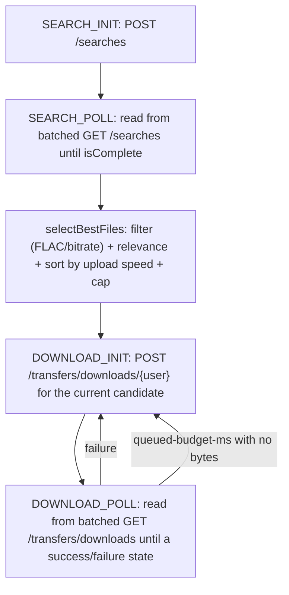

# slskd Integration

> Status: current as of 2026-08-13, branch `durable-download-state-machine`. Agent-oriented guide - the cited source files are the source of truth; verify before relying.

slskd is the Soulseek daemon Naviseerr uses to search the Soulseek network and download files. This subsystem searches, picks the best candidate files, enqueues a download, and drives it to completion with retry/failover. It is fully reactive (`Mono`/`Flux`), and — since the durable-download-state-machine work — driven by the pass loop in [download-manager.md](download-manager.md) rather than by an in-process poll-until-done chain.

## Flow at a glance

Both "poll until done" chains that used to live in this subsystem (`SlskdSearchResultProcessor.pollUntilComplete` and `SlskdDownloadProcessor.pollUntilComplete`) are gone. In their place, each is now four independent one-call steps, driven by [DownloadStateMachine](download-manager.md#the-four-phases) across passes of the loop:

A completed search's candidates are computed once (in `SEARCH_POLL`) and carried forward as JSON on the task row (`DownloadCandidate`, not the raw slskd DTOs), so `DOWNLOAD_INIT`/`DOWNLOAD_POLL` never need to re-fetch or re-rank them. On a transfer failure, the loop either retries the same candidate (up to `slskd-service.retry-count`) or advances to the next one — see `DownloadStateMachine.retryOrAdvanceCandidate` and the phase table in [download-manager.md](download-manager.md#the-four-phases). A candidate that has kept the transfer waiting with no bytes moved (`Queued, Remotely`/`Requested`/`Initializing`, or `InProgress` at 0 bytes) for `download-task.queued-budget-ms` is abandoned straight to the next candidate, skipping same-peer retries; `Queued, Locally` (slskd's own slot backlog) does not count. The abandoned transfer is left alive in slskd — there is no cancel call yet.

## HTTP client

- [SlskdConfig.java](../../src/main/java/com/catacomb5099/naviseerr/services/slskd/SlskdConfig.java) builds the `slskdWebClient` bean: base URL `slskd-service.url`, default header `X-API-Key: slskd-service.api_key`. Since 19-10-2026 its `build(url, apiKey)` makes the same client for any slskd: [SlskdSettingsController](../../src/main/java/com/catacomb5099/naviseerr/settings/SlskdSettingsController.java) (`GET|PUT|DELETE /settings/slskd`, "Use my own slskd" on the first-run setup) tests the typed address and key with one `GET /server`, stores them in `install_settings` and hands the new client to `SlskdService.use()`, which swaps its `volatile` `WebClient` so the next call goes there; the install file's values are the fallback (`DELETE`). Not checked there: naviseerr must still see that slskd's downloads folder (`SLSKD_DOWNLOADS_DIR`), or nothing is filed.
- [SlskdService.java](../../src/main/java/com/catacomb5099/naviseerr/services/slskd/SlskdService.java) wraps the raw calls (all return `Mono`/`Flux`):
  - `searchResults(query)` -> `POST /searches` with body `{searchText, searchTimeout}` -> `SearchState` (carries the search `id`). Backs `SEARCH_INIT`, and since 19-10-2026 a person's own search from the manual-import pop-up (`ManualSearch`, one call with the text as typed, then `getSearchWithResponses` every poll interval until complete or `manual-search-budget-ms`).
  - `getAllSearches()` -> `GET /searches` -> `Flux<SearchState>`, every search slskd currently knows about, collected into a map by id once per pass. Backs the `isComplete` gate in `SEARCH_POLL`. **Summaries only:** this endpoint takes no `includeResponses` parameter and always returns `responses` empty, however many results the search really found — so it can say *whether* a search is done but never *what it found*.
  - `getSearchWithResponses(searchId)` -> `GET /searches/{id}?includeResponses=true` -> `SearchState` including `responses`. The only endpoint that populates them, so it is the required follow-up to `getAllSearches()` before candidate selection. Called once per download, on the transition to complete — not once per poll.
  - `enqueueDownload(username, file)` -> `POST /transfers/downloads/{username}` with a one-element file list -> `QueueDownloadResponse` (`enqueued`, `failed`). Backs `DOWNLOAD_INIT`.
  - `getAllDownloads()` -> `GET /transfers/downloads` -> `Flux<TransferedFile>`, every transfer slskd currently knows about, collected into a map by id once per pass. Backs `DOWNLOAD_POLL`. **The response is nested, not flat:** transfers are grouped by peer and then by directory (`UserTransfers` -> `TransferDirectory` -> `TransferedFile`), unlike `getDownloadProgress` which returns a bare transfer, so this method flattens two levels. Reading it flat yields one all-null transfer per peer and a lookup map keyed by `null`. `SlskdServiceTransfersShapeTest` pins the shape against live-captured JSON.
  - `getDownloadProgress(username, downloadId)` -> `GET /transfers/downloads/{username}/{downloadId}` -> `TransferedFile`. Kept, but not called by the default path — it is the documented fallback for `getAllDownloads()` (see "Accepted risk" below), not currently wired into `DownloadStepExecutor`.
  - `getServerState()` -> `GET /server` (behind `GET /status`), `getOptions()` -> `GET /options` (the configured username).
  - `connect()` -> `PUT /server` (no body; 200, or 205 when slskd was already retrying) and `disconnect(reason)` -> `DELETE /server` with the reason as a bare JSON string (204). Used by `SoulseekAccountController` after it has rewritten the account in `slskd.yml`: slskd's connection watchdog reads username and password from its current options on every attempt, and those options follow the file (slskd watches it), so disconnect-then-connect applies a new account without restarting the container. Neither call is retried; a failure is logged and `GET /status` tells the outcome.

## The Soulseek account (19-10-2026)

The install's account lives in two files `setup` writes under the data folder (`install.data-dir`, `/data` in the compose install): `slskd/slskd.yml` (what slskd logs in with) and `config/secrets.env` (what setup renders the yml from on the next start). [SoulseekAccountFiles](../../src/main/java/com/catacomb5099/naviseerr/settings/SoulseekAccountFiles.java) reads and rewrites the two account lines in each, leaving everything else as it was; [SoulseekAccountController](../../src/main/java/com/catacomb5099/naviseerr/settings/SoulseekAccountController.java) serves `GET`/`PUT /settings/soulseek` (AGENTS.md has the contract). Not slskd's own options API on purpose: `PATCH /options` is a volatile overlay without the credentials, and `PUT /options/yaml` needs a browser session with slskd's web password, not an API key. Off when the data folder is not configured.

`GET /searches` and `GET /transfers/downloads` are each fetched **once per pass**, and only when at least one row claimed in that pass actually needs one — see [download-manager.md](download-manager.md#batching-the-two-poll-phases) for the batching mechanics and why it turns "one call per download per poll" into "at most two calls per pass."

### Accepted risk: no filter on `GET /transfers/downloads`

Unlike `GET /searches`, `GET /transfers/downloads` has no pagination, date filter, or state filter — only `includeRemoved` — so its response size on an install with years of accumulated transfer history remains an open question (first flagged during Task 4 of the implementation plan). **Partially checked on 2026-08-19:** a live instance with one transfer returned 696 bytes, which confirms the endpoint's *shape* (see above) but says nothing about its size at history scale. slskd retains completed transfers — `removed: false` on a finished one — so growth is real; it just has not been measured.

What has changed since the original assessment: `DownloadTaskRunner` now filters the response down to the transfer ids of the rows claimed in the current pass before building the lookup map. That bounds *our memory and the map* by our own concurrency regardless of history, though not the response body itself, which is still transferred and parsed in full. If the body size does become a problem, the documented fallback is unchanged: per-transfer polling via `getDownloadProgress`, parallelised instead of read from a shared map — a same-shape swap limited to one branch in `DownloadStepExecutor` and one call site in `DownloadTaskRunner`.

## Search + candidate selection

[SlskdSearchResultProcessor.java](../../src/main/java/com/catacomb5099/naviseerr/services/slskd/SlskdSearchResultProcessor.java):

- `selectBestFiles(state, query, wording, albumTrackSeconds, chosen)` builds the ordered candidate list of `Pick`s (`chosen` is the install's download quality, `install_settings.download_quality`, read once per completed search):
  1. flatten every `(response item, file)` pair from `state.getResponses()`,
  2. keep files that have a quality tier (`DownloadQuality.of`: lossless by the file name's suffix, flac, wav, aif, aiff, ape, wv, not slskd's often-blank `extension`; else by the reported bit rate, Very high >= 288, High 224-287, Normal 160-223, Low 1-159). A lossy file with no reported bit rate has no tier and is dropped (2.7% of files). Since 19-10-2026; before, lossy files under `slskd-service.min-bit-rate` (320) were dropped,
  3. keep files whose filename is relevant to the query via [TrackMatchingService](#track-matching); for an album's song (P6, `albumTrackSeconds` = the album row's length) also drop files whose slskd length is outside max(10 s, 3%) of it (`lengthTolerance`), so a live album's "03 - Mr. Jones.flac" is not taken for the studio track; a file with no length stays,
  4. sort: the grade (requested version first), an overloaded sharer last, the chosen tier then the nearest (`DownloadQuality.distance`, ties going up), the length most files of the grade share, then availability (`hasFreeUploadSlot`, then `queueLength`, then `uploadSpeed` descending, `SlskdSearchResultProcessor.BY_AVAILABILITY`),
  5. cap to `slskd-service.max-files-per-download`.
- `DownloadStepExecutor` calls this only once a `SEARCH_POLL` sees `isComplete = true`, then converts the result to `DownloadCandidate` (see [download-manager.md](download-manager.md)) for storage on the task row.
- An album download's own search (P5) is judged by [AlbumFolderPicker](../../src/main/java/com/catacomb5099/naviseerr/download/AlbumFolderPicker.java) instead, which reuses the same tier rule (`DownloadQuality.of`), this class's overload test (`isOverloaded`) and `TrackMatchingService.grade`, and looks for a sharer's folder (disc subfolders merged) holding every track of the album, else at least half of them (P6); see [download-manager.md](download-manager.md#whole-album-first-p5-04-10-2026). The 10-file cap above does not apply there.

### Track matching

[TrackMatchingService.java](../../src/main/java/com/catacomb5099/naviseerr/util/TrackMatchingService.java) uses fuzzywuzzy. `isMatch(cleanTitle, filePath)` returns true if any of: `tokenSortRatio >= 75`, `partialRatio >= 85`, or both extracted artist and title substrings appear in the normalized filename. `normalize(...)` strips extensions, track numbers, bracketed content, common metadata terms, years, and non-alphanumerics. `extractParts(...)` assumes an `"-"` separator between artist and title (noted TODO) - see [gotchas.md](gotchas.md).

A filename carrying a DJ-pool signature (`Clean`/`Dirty`, `Intro`/`Outro`, `Transition`, `Hype`, key+BPM tags like `12A 125`, `dj-promo`) is not the song, unless the request itself carries that word: "Intro - The xx" may match `01 - Intro.flac` and "Rather Be - Clean Bandit" may match `Clean Bandit - Rather Be.mp3`, but "Wonderwall - Oasis" never matches `Wonderwall (Clean Intro DJ Edit).mp3`. A word in the file's brackets is a DJ flag, excused only when the request has it in brackets too: "Clean - Taylor Swift" never matches `Taylor Swift - Style (Clean).mp3`, while "Smack That (Clean) - Akon" may match `Akon - Smack That (Clean).mp3` (`TrackMatchingService.isDjPoolEdit`).

## Search state

[SlskdSearchState.java](../../src/main/java/com/catacomb5099/naviseerr/schema/slskd/SlskdSearchState.java) classifies slskd's search-state string, mirroring `TransferState`'s shape: `NONE`, `REQUESTED`, `IN_PROGRESS`, `COMPLETED`, `TIMED_OUT`, `RESPONSE_LIMIT_REACHED`, `FILE_LIMIT_REACHED`, and the two failure states `CANCELLED`/`ERRORED`. slskd reports compound states like `"Completed, TimedOut"`, so `parse(state)` comma-splits before matching, same as `TransferedFileUtil`. `isFailure(state, responseCount)` is what `DownloadStateMachine.afterSearchPoll` checks (an `Errored` search holding responses is not a failure: slskd ends a search that way when its response cap overflows) before falling through to the completion/still-running branches.

**Note the asymmetry:** `TimedOut` is a *failure* for a transfer (`TransferState.TIMED_OUT.isFailure() == true`) but *normal completion* for a search — slskd finishes a search by running out its own timeout, and a timed-out search with usable candidates should proceed exactly like one that completed any other way. `SlskdSearchState.TIMED_OUT` is not in the failure set for this reason.

These values are unverified guesses at the real slskd API strings, not confirmed against a live instance — see the note in [gotchas.md](gotchas.md). The design is deliberately robust to getting them wrong: `isFailure` only returns `true` for a state it explicitly recognises as a failure, so an unrecognised or misspelled state string falls through to the "completed with no usable candidates" path (`NO_CANDIDATES`) rather than being silently treated as success.

## Transfer states

[TransferState.java](../../src/main/java/com/catacomb5099/naviseerr/schema/slskd/TransferState.java) enumerates slskd transfer states with `success`/`failure` flags:

- Success: `SUCCEEDED`.
- Failure: `CANCELLED`, `TIMED_OUT`, `ERRORED`, `REJECTED`, `ABORTED`.
- Everything else (`QUEUED`, `INITIALIZING`, `IN_PROGRESS`, `COMPLETED`, ...) is "in progress" -> keep polling, except that after `download-task.queued-budget-ms` with no bytes moved (and not `Queued, Locally`) the candidate is abandoned for the next one. That clock restarts at every poll while the same sharer is sending us another of our files (P9: waiting our turn, not stalling; see [download-manager.md](download-manager.md#one-sharer-many-songs-p9-04-10-2026)).

slskd reports compound states like `"Completed, Succeeded"`, so the state string is comma-split before matching. [TransferedFileUtil.getStateList](../../src/main/java/com/catacomb5099/naviseerr/util/TransferedFileUtil.java) does this parsing, matching against `TransferState.getValue()` (the slskd string, e.g. `"InProgress"`, `"TimedOut"`) — not the enum `name()`. `DownloadStateMachine.afterDownloadPoll` treats any success state as `Terminal SUCCEEDED` and any failure state as a retry/next-candidate decision.

## naviseerr owns candidate-level retry, deliberately

slskd 0.26.0 added its own per-file retry with real exponential backoff and partial-file resume (`transfers.download.retry.*`, in slskd's own config), which overlaps with `slskd-service.retry-count`. naviseerr keeps both of its retry tiers (same-peer retry, then next-candidate failover) rather than delegating the same-peer tier to slskd, because splitting the concern would mean naviseerr can no longer fully explain its own retry behaviour, and slskd has no visibility into the ranked candidate list so it could only ever take on one of the two tiers anyway. See [docs/decisions/durable-download-state-machine-13-08-2026.md](../decisions/durable-download-state-machine-13-08-2026.md) ("naviseerr keeps candidate-level retry; does not hand any of it to slskd") for the full rationale, including the unresolved compounding-retry risk this leaves and the operational mitigation (pin `transfers.download.retry.attempts` to `0`/`1` on the slskd side).

## Configuration knobs (`slskd-service.*` in application.yaml)

- `url`, `api_key` - client config.
- `timeout` - search timeout sent to slskd.
- `max-files-per-download` (10) - candidate list cap.
- `retry-count` (2) - per-candidate failover retries, consumed by `DownloadStateMachine`, not by an in-process poller.

Per-phase poll intervals and duration budgets (`search-poll-interval-ms`, `download-poll-interval-ms`, `search-budget-ms`, `download-budget-ms`, `queued-budget-ms`) now live under `download-task.*` — see [download-manager.md](download-manager.md#configuration-download-task-in-applicationyaml). The old `slskd-service.max-poll-attempts` and `slskd-service.first-back-off-duration-ms` knobs are gone (removed in Task 6, along with the poller they configured), not merely unused.

## Related docs

- Reactive patterns (the pass loop, row-level concurrency): [reactive-patterns.md](reactive-patterns.md)
- How downloads are driven end-to-end: [download-manager.md](download-manager.md)
- Known issues: [gotchas.md](gotchas.md)
